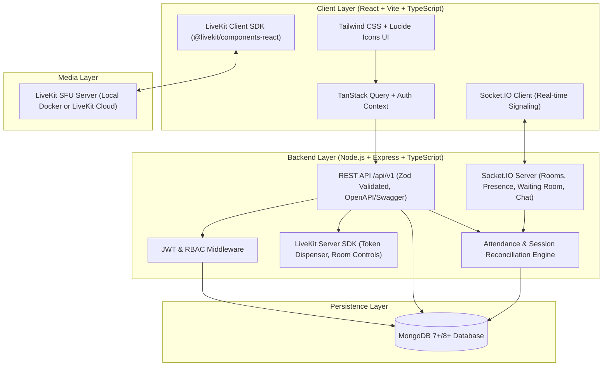

# MeetSpace — Advanced Video Conferencing Platform

[](https://developer.mozilla.org/en-US/docs/Web/JavaScript)
[](https://react.dev/)
[](https://nodejs.org/)
[](https://livekit.io/)
[](https://socket.io/)
[](https://www.mongodb.com/)
[](https://tailwindcss.com/)

**MeetSpace** is a modern, production-grade video conferencing and team collaboration platform inspired by Zoom and Google Meet. It features high-definition WebRTC video/audio routing powered by a Selective Forwarding Unit (LiveKit SFU), real-time signaling via Socket.IO, secure JWT and cookie-based authentication, persistent meeting management, waiting room admissions, role-based host moderation, in-meeting chat, and attendance tracking with CSV export.

---

## 🏛 Architecture Diagram



---

## 🚀 Key Features

### 1. Live Conference & Media Transport
- **SFU WebRTC Routing**: Powered by LiveKit for adaptive bitrate, simulcast, and low-latency browser-to-browser media transport.
- **Pre-Join Audio/Video Setup**: Real local webcam preview, microphone volume level meter, camera & microphone toggles, and hardware device selector (`navigator.mediaDevices.enumerateDevices`).
- **Adaptive Layouts**: Dynamic 1-on-1 speaker view, responsive video tile grid, and presenter spotlight view on screen share.
- **Active Speaker Highlighting**: Instant visual borders and indicators for the active speaker.
- **Host Controls**: Mute participants, remove attendees, and terminate meeting for all participants.

### 2. Waiting Room & Moderation
- **Host Admission Queue**: When waiting room is enabled, attendees are placed on a branded holding screen.
- **Real-Time Admission/Rejection**: The host receives instant prompts with 1-click **Admit** and **Reject** buttons in the participant drawer.
- **Strict Backend Authorization**: Tokens and room credentials are only issued after explicit host admission.

### 3. Persistent Meeting Management & Scheduling
- **Instant Meetings & Scheduled Calls**: Create rooms immediately or schedule future meetings with timezone support.
- **Shareable Links & Passcodes**: Readable meeting codes (e.g. `eng-sync-2025`) and optional passcode protection.
- **Calendar Export**: Automated RFC 5545 iCalendar (`.ics`) file generation compatible with Google Calendar, Apple, and Outlook.
- **In-App Invitations**: Invite colleagues by email with instant link generation.

### 4. Real-Time Chat & Hand Raising
- **Persistent Chat**: Messages saved directly to MongoDB and broadcasted via Socket.IO.
- **System Events**: Automated notifications for user join, leave, admission, and hand raises.
- **Interactive Reactions**: Raise hand toggle with animated badges on video tiles.

### 5. Attendance Auditing & CSV Reporting
- **Accurate Duration Engine**: Captures join and leave timestamps per participant session.
- **Multi-Session Reconnection Reconciliation**: Handles disconnects/refreshes cleanly without duplicate double-counting.
- **CSV Export**: One-click download of official attendance reports with participant emails, entry/exit timestamps, and active minutes.

### 6. Interactive OpenAPI / Swagger Documentation
- Complete API specification accessible at `http://localhost:5001/api/docs`.

---

## 🛠 Tech Stack

| Domain | Technology |
|---|---|
| **Frontend** | React 18 (JSX), JavaScript, Vite, Tailwind CSS, Lucide Icons, Date-Fns |
| **Media Client** | `@livekit/components-react`, `livekit-client` |
| **Server State** | `@tanstack/react-query` |
| **Backend** | Node.js (ESM), Express.js, JavaScript |
| **Real-time** | Socket.IO (Signaling, Chat, Hand Raises, Waiting Room) |
| **Media Service** | LiveKit Server SDK (`livekit-server-sdk`) + LiveKit SFU |
| **Database** | MongoDB 7.0 / 8.0 with Mongoose ODM |
| **Security** | JWT (HttpOnly Cookies + Bearer Token), Bcrypt.js, Helmet, Express-Rate-Limit, Zod |
| **Testing** | Vitest, Supertest |
| **DevOps** | Docker, Docker Compose, Nginx |

---

## ⚡ Quick Start & Local Development

### Prerequisites
- **Node.js**: v18+ (v20+ recommended)
- **MongoDB**: Running locally on port `27017` or a MongoDB Atlas connection string.
- **LiveKit Server**:
  - Local binary: `livekit-server --dev` (downloads from [LiveKit Releases](https://github.com/livekit/livekit/releases))
  - Or Docker: `docker run --rm -p 7880:7880 livekit/livekit-server --dev`
  - Or free cloud instance at [cloud.livekit.io](https://cloud.livekit.io)

### 1. Installation

Clone the repository and install all dependencies:
```bash
git clone <repo-url>
cd meetspace
npm install
```

### 2. Configure Environment

Copy the `.env.example` file:
```bash
cp .env.example server/.env
```

Ensure the following default values in `server/.env`:
```env
PORT=5001
NODE_ENV=development
CLIENT_URL=http://localhost:5173
MONGODB_URI=mongodb://127.0.0.1:27017/meetspace
JWT_SECRET=super-secret-meetspace-jwt-token-key-2025-at-least-32-chars
LIVEKIT_URL=ws://localhost:7880
LIVEKIT_API_KEY=devkey
LIVEKIT_API_SECRET=secret
```

### 3. Seed the Database

Populate demo users and sample meetings:
```bash
npm run seed
```

**Pre-seeded Demo Accounts:**
- **Host Account**: `host@meetspace.dev` / `password123`
- **Participant Account**: `alex@meetspace.dev` / `password123`
- **Admin Account**: `admin@meetspace.dev` / `password123`

### 4. Run the Application

Start both the backend API and frontend client concurrently:
```bash
npm run dev
```

- **Frontend Client**: [http://localhost:5173](http://localhost:5173)
- **Backend API**: [http://localhost:5001](http://localhost:5001)
- **Swagger Docs**: [http://localhost:5001/api/docs](http://localhost:5001/api/docs)

---

## 🧪 Running Automated Tests

Run the full integration test suite (Auth, Meeting Lifecycle, Passcode, Waiting Room permissions, Attendance Session reconciliation & CSV generation):

```bash
npm test
```

Sample test output:
```
 ✓ tests/attendance.test.ts (4 tests)
 ✓ tests/auth.test.ts (5 tests)
 ✓ tests/meeting.test.ts (7 tests)

 Test Files  3 passed (3)
      Tests  16 passed (16)
```

---

## 🐳 Docker Deployment

To launch the complete isolated production stack with MongoDB, LiveKit SFU, Backend API, and Nginx-powered Client:

```bash
docker-compose up --build
```

Access the platform at:
- Web Application: [http://localhost:5173](http://localhost:5173)
- Swagger API Docs: [http://localhost:5001/api/docs](http://localhost:5001/api/docs)

---

## 📖 API Reference (`/api/v1`)

### Authentication & Users
- `POST /api/v1/auth/register` — Register a new account
- `POST /api/v1/auth/login` — Authenticate and receive JWT session
- `POST /api/v1/auth/logout` — Invalidate session and clear cookies
- `GET /api/v1/auth/me` — Retrieve current authenticated profile
- `PUT /api/v1/auth/profile` — Update display name, timezone, avatar URL
- `PUT /api/v1/auth/password` — Change password with current password verification

### Meeting Management
- `POST /api/v1/meetings` — Create an instant or scheduled meeting
- `GET /api/v1/meetings` — List upcoming & past meetings with pagination and search
- `GET /api/v1/meetings/:code` — Retrieve pre-join details and permission requirements
- `PATCH /api/v1/meetings/:id` — Update meeting settings (Host only)
- `DELETE /api/v1/meetings/:id` — Cancel meeting (Host only)
- `POST /api/v1/meetings/:code/join` — Request room access, validate passcodes & waiting room, issue LiveKit token
- `POST /api/v1/meetings/:code/end` — Terminate meeting for all attendees (Host only)

### Invitations & Calendar
- `POST /api/v1/meetings/:id/invite` — Send invitations to emails
- `GET /api/v1/meetings/:id/invitations` — List meeting invitations
- `GET /api/v1/meetings/:id/ics` — Download RFC 5545 iCalendar (`.ics`) file

### Real-Time Chat & Attendance
- `GET /api/v1/meetings/:code/messages` — Retrieve historical chat messages
- `GET /api/v1/meetings/:id/attendance` — View aggregated attendance summary
- `GET /api/v1/meetings/:id/attendance/csv` — Export official attendance report as CSV

---

## 🛡️ Security & Reliability Decisions

1. **Backend Privilege Enforcement**:
   - Privileged operations (admitting waiting participants, muting, removing attendees, ending meetings) are enforced on the backend by matching `req.user.id` against `meeting.hostId`. Client-side buttons are merely UI affordances.
2. **Media Secret Isolation**:
   - LiveKit API keys and secrets reside exclusively on the Node.js server. The client only receives short-lived, cryptographically signed room tokens.
3. **Graceful Session Reconciliation**:
   - Attendance sessions handle unexpected client browser closures or refreshes by capturing socket disconnection events and reconciles all open sessions upon meeting conclusion.
4. **Brute Force & Rate Limiting**:
   - Authentication routes are rate-limited to 30 attempts per 15-minute window to prevent credential stuffing.
